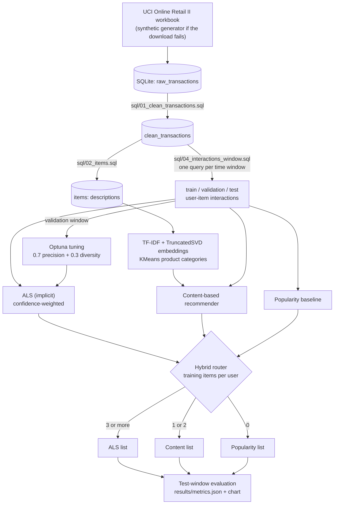
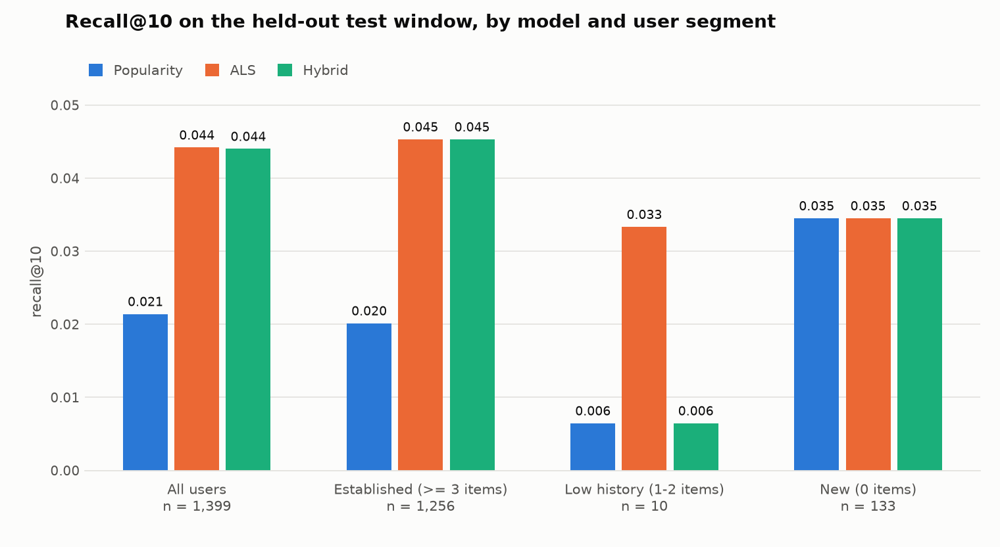

# collaborative-recommender-engine

An implicit-feedback recommender for retail transactions: ALS matrix factorisation for
customers with purchase history, a content-based fallback for customers without enough of
it, and an evaluation that is strict about time. Built on the public
[UCI Online Retail II](https://archive.ics.uci.edu/dataset/502/online+retail+ii) dataset
(two years of invoices from a UK online gift wholesaler).

Every number in this README is generated from `results/metrics.json` by the pipeline itself.
Nothing is typed in by hand, and the results that are unflattering are reported next to the
ones that are not.

## Overview

| Piece | What it does |
|---|---|
| SQL layer (`sql/`, SQLite) | Cleans raw invoice lines and aggregates them into user-item interactions |
| Chronological split | Last 4 weeks = test, the 4 weeks before = validation, everything earlier = train |
| Popularity baseline | Most widely bought products the customer does not already own |
| ALS (`implicit`) | Confidence-weighted matrix factorisation on purchase counts |
| Content fallback | TF-IDF -> TruncatedSVD description embeddings, KMeans product categories, nearest items to the customer's profile |
| Hybrid router | Fewer than 3 training interactions -> content fallback, otherwise ALS |
| Tuning (Optuna) | Objective balances precision@10 with intra-list diversity |
| Evaluation | Recall@10, precision@10, NDCG@10, diversity, catalogue coverage, per user segment |

## Problem framing: why implicit feedback

A purchase log says what customers bought and never what they disliked. There are no
ratings, and a missing (customer, product) pair is ambiguous: it may mean "not interested" or
simply "never saw it". Three consequences shape the design:

1. **Confidence, not ratings.** ALS is fitted in the Hu-Koren-Volinsky form: every pair is a
   binary preference, and observed pairs get a confidence `c = 1 + alpha * w(count)` that
   grows with how often the customer bought the product. Unobserved pairs keep confidence 1
   rather than being treated as dislikes.
2. **Ranking metrics on future purchases.** With no ratings to predict, the only honest test
   is whether the top-k list contains what the customer went on to buy. That requires a
   split by time: a random split would let the model see the future.
3. **Accuracy alone rewards blandness.** With only positives, the safest prediction is
   always a best-seller. Tuning therefore optimises precision *and* diversity, and catalogue
   coverage is reported alongside.

## Architecture



## How to run

Requires Python 3.12. The pinned versions were tested on Windows 11.

```bash
python -m venv .venv
.venv/Scripts/python -m pip install -r requirements.txt   # .venv/bin/python on Linux/macOS
.venv/Scripts/python -m src.run_all                       # data -> tune -> evaluate
.venv/Scripts/python -m pytest -q
```

Or with make: `make setup`, `make data`, `make train`, `make evaluate`, `make test`.

Individual stages:

| Command | What it does | Time on a laptop |
|---|---|---|
| `python -m src.run_all --stage data` | Downloads the workbook (~45 MB), loads SQLite, runs the SQL scripts | ~4 min, mostly parsing the .xlsx |
| `python -m src.run_all --stage tune` | 60 Optuna trials for ALS + content grid, on the validation window | ~3 min |
| `python -m src.run_all --stage evaluate` | Refits on train+validation, scores the test window, writes `results/` | ~30 s |

If the download fails, the data stage falls back to a synthetic generator (power-law item
popularity, customers with category tastes, 12 months of timestamps, deliberately dirty
rows). `--synthetic` forces that path. The data source is recorded in `metrics.json` and
printed at the top of the results below, so synthetic numbers can never pass for real ones.

Raw data and the SQLite database live in `data/`, which is git-ignored.

## Results

<!-- RESULTS:START -->
_Generated by `python -m src.run_all` from `results/metrics.json`. Data: UCI Online Retail II._

**Data.** 1,067,371 raw invoice lines -> 776,577 clean purchase lines -> 480,971 user-item interactions (5,852 customers, 4,619 products).

**Split.** Train+validation `2009-12-01` to `2011-11-12` (exclusive), test `2011-11-12` to `2011-12-10` (exclusive). 1,399 test users have at least one new item in the test window.

### Test set, all 1,399 users

| Model | Recall@10 | Precision@10 | NDCG@10 | Diversity | Coverage |
|---|---|---|---|---|---|
| Popularity (global baseline) | 0.0214 | 0.0340 | 0.0375 | 0.893 | 1.7% |
| Popularity, last 28 days (reference) | 0.0459 | 0.0689 | 0.0826 | 0.886 | 1.0% |
| ALS | 0.0442 | 0.0578 | 0.0725 | 0.825 | 31.3% |
| Hybrid (ALS + content fallback) | 0.0440 | 0.0578 | 0.0725 | 0.826 | 31.2% |

**Headline.** Hybrid recall@10 is 0.0440 against 0.0214 for the global popularity baseline: a relative lift of **+105.6%** (95% paired-bootstrap interval +68.7% to +154.8%). Against the stronger last-28-days popularity reference the lift is -4.1%.

### User segments

| Segment (training history) | Test users | Share | Served by |
|---|---|---|---|
| Established (>= 3 items) | 1,256 | 89.8% | ALS |
| Low history (1-2 items) | 10 | 0.7% | content-based fallback |
| New (0 items) | 133 | 9.5% | popularity (no profile possible) |

So **10.2%** of evaluated test users are below the 3-interaction threshold, almost all of them brand-new customers. Among the 5,719 customers in the training data, 178 (3.1%) have fewer than 3 distinct items.

### Recall@10 by segment

| Model | All users | Established (>= 3 items) | Low history (1-2 items) | New (0 items) |
|---|---|---|---|---|
| Popularity (global baseline) | 0.0214 | 0.0201 | 0.0065 | 0.0345 |
| Popularity, last 28 days (reference) | 0.0459 | 0.0472 | 0.0469 | 0.0333 |
| ALS | 0.0442 | 0.0453 | 0.0333 | 0.0345 |
| Hybrid (ALS + content fallback) | 0.0440 | 0.0453 | 0.0065 | 0.0345 |



### Simulated cold-start (test set)

Only 10 real test users have 1-2 training items, too few to judge the content fallback. To measure it properly, each established test user's history is hidden except for their 1 or 2 most recent items, and each model must recommend from that alone (ALS re-solves the user vector from the visible items).

**1 visible item** (1,256 users)

| Model | Recall@10 | Precision@10 | NDCG@10 | Diversity | Coverage |
|---|---|---|---|---|---|
| Popularity | 0.0201 | 0.0309 | 0.0341 | 0.891 | 1.7% |
| Content-based fallback | 0.0225 | 0.0312 | 0.0348 | 0.882 | 2.6% |
| ALS (fold-in) | 0.0298 | 0.0306 | 0.0398 | 0.657 | 40.0% |

**2 visible items** (1,256 users)

| Model | Recall@10 | Precision@10 | NDCG@10 | Diversity | Coverage |
|---|---|---|---|---|---|
| Popularity | 0.0201 | 0.0309 | 0.0341 | 0.891 | 1.7% |
| Content-based fallback | 0.0228 | 0.0318 | 0.0354 | 0.883 | 2.4% |
| ALS (fold-in) | 0.0353 | 0.0400 | 0.0517 | 0.691 | 36.9% |

### Tuned hyperparameters (chosen on validation)

- ALS (60 Optuna trials): factors=68, regularization=0.5473, iterations=28, alpha=0.2673, weighting=bm25
- Content fallback (grid): category_weight=0.0, popularity_weight=16.0
- Objective: 0.7 x relative precision@10 + 0.3 x relative diversity (best value 1.704; popularity scores 1.000 by definition)
<!-- RESULTS:END -->

### Reading the results

- **ALS roughly doubles the recall of the global popularity baseline**, with far higher
  catalogue coverage (popularity recommends the same handful of products to everyone).
- **A recency-windowed popularity list beats ALS on this test window**: slightly on recall,
  clearly on precision and NDCG. The test window is the Christmas peak, and "what sold in
  the last four weeks" captures the seasonal products that an all-time ranking and a
  time-agnostic ALS both miss. It is reported as a reference precisely because it is the
  tougher yardstick; the headline lift is quoted against the global baseline that the
  project set out to beat. ALS still recommends from a far larger share of the catalogue.
- **The hybrid and plain ALS are nearly identical overall**, because the router changes the
  outcome for under 1% of test users. Cold-start in this dataset is dominated by brand-new
  customers, for whom no model has anything to personalise on.
- **The content fallback is the weakest component.** On the handful of real low-history
  test users it does worse than ALS (a sample far too small to conclude from). In the
  simulated cold-start, which has a proper sample, it beats popularity only slightly, while
  ALS re-solved from the same 1-2 items gets clearly higher recall at the cost of much lower
  diversity. On this data the evidence favours lowering the ALS threshold rather than
  routing those users to content similarity.

## Design decisions

**Purchase occasions, not quantities.** An interaction's strength is the number of distinct
invoices on which the customer bought the product. Summed quantity mostly reflects pack
sizes in wholesale data (a customer buying 144 of something is not 144 times more
interested).

**The split is enforced in SQL.** Each of train, validation and test is produced by the same
windowed query (`sql/04_interactions_window.sql`) with different time bounds, so an
interaction cannot land in the wrong set. Tests assert that the windows are disjoint and that
training counts exclude later purchases.

**Ground truth = products new to the customer.** Recommenders filter out products the
customer already bought, so repeat purchases can never be hits. A customer's targets are the
products bought in the hold-out window that they had not bought before it; customers with no
such product are not evaluated. Hold-out products that never appeared in training stay in
the targets and count as misses for every model.

**Final models are refitted on train + validation.** Hyperparameters are chosen on the
validation window using models fitted on train only; the chosen configuration is then
refitted on everything before the test window. The test window is scored once.

**The tuning objective.**
`0.7 * (precision@10 / popularity precision@10) + 0.3 * (diversity / popularity diversity)`.
Both terms are ratios to the popularity baseline on the same users, which puts them on a
common scale without inventing a normalisation constant. Diversity is one minus the mean
pairwise cosine similarity of the recommended products' description embeddings. The 0.7 /
0.3 weighting was fixed before any tuning run. All 60 trials, with every metric, are in
`results/optuna_trials.csv`.

**Confidence weighting is tuned, not assumed.** The search covers raw counts, `log1p`
counts and BM25 weights together with `alpha`. BM25 won: it damps both the heaviest buyers
and the blockbuster products.

**"ALS" still needs a fallback for brand-new customers.** A customer absent from training
has no user factors, so the ALS row in the tables uses popularity for those customers. The
hybrid row differs from it only for customers with 1-2 training items. That keeps the
comparison about the router and nothing else.

**The content fallback is tuned on simulated cold-start.** Too few validation users have
1-2 training items to tune on, so established validation users are evaluated with only their
1 or 2 most recent products visible, using the same objective. The grid
(`results/content_tuning.csv`) selected the largest popularity weight and no category
blending, meaning that under a precision-and-diversity objective the best "content" model is
a popularity ranking nudged by description similarity. Configurations that lean harder on
similarity had higher recall on validation but much lower diversity (near-duplicate
products), and the objective rejected them.

**Determinism.** One seed (`src/config.py`) drives ALS initialisation, SVD, KMeans, the
Optuna sampler and the bootstrap. `OPENBLAS_NUM_THREADS=1` is set on import, as `implicit`
recommends.

## Limitations

- **One test window, in the Christmas peak.** Four weeks of one year. The bootstrap interval
  on the headline lift covers sampling noise across users, not variation across seasons.
- **The headline baseline is a weak one.** Global all-time popularity is the conventional
  baseline and the one this project was specified against, but the last-28-days reference
  shows that the gap disappears once the baseline is allowed to know what is in season.
- **ALS is time-agnostic.** A purchase from two years ago weighs the same as one from last
  week, which is the likely reason a recency-aware popularity list outperforms it here.
- **The content model is limited by its input.** Product descriptions are 3-5 words;
  embeddings of them cluster on shared words ("PINK", "HEART") as much as on product type.
- **The real low-history segment is tiny**, so its per-segment metrics are noise. The
  simulated cold-start is the meaningful measurement, and it reuses item factors that were
  trained with those users' full histories, which flatters the ALS fold-in somewhat.
- **Offline metrics only.** Recall on logged purchases cannot tell whether a recommendation
  would have caused a purchase, and it penalises good recommendations the customer never saw.
- **B2B data.** Many customers are small retailers restocking; results may not transfer to
  consumer retail.

## Future work

- Time-decayed confidence in ALS, and a recency-aware popularity fallback for new customers.
- Rolling-origin evaluation over several windows instead of a single hold-out.
- Choose the router threshold from data (the simulated cold-start suggests ALS is already
  competitive at 1-2 items) instead of fixing it at 3.
- Re-rank ALS candidates for diversity (e.g. MMR) rather than only tuning for it.
- Richer item content: sentence embeddings of descriptions, price band, co-purchase graph.
- Stronger collaborative baselines for context (item-kNN, BPR, EASE).

## Repository layout

```
sql/                    cleaning, item table, interaction aggregation, windowed split query
src/
  config.py             paths, seed, split and routing constants
  data/                 dataset download and synthetic fallback generator
  sql/                  SQLite helpers that execute the .sql files
  split.py              chronological train / validation / test split
  interactions.py       sparse interaction matrix, ground-truth construction
  models/               popularity, ALS, content-based, hybrid router
  evaluation/           metrics, evaluation, chart, README results rendering
  tuning.py             Optuna objective for ALS, grid for the content model
  run_all.py            CLI entry point
tests/                  pytest suite
notebooks/eda.ipynb     short exploratory analysis
results/                metrics.json, tuning logs, chart (committed; data/ is not)
```

## Tests

`pytest -q` runs in a few seconds on a small synthetic dataset pushed through the
real SQL pipeline. They cover the cleaning rules, the absence of temporal leakage in the
split, the metric functions against hand-computed values (recall@k, precision@k, NDCG@k,
diversity, coverage), the router threshold of 3, and that no model ever recommends a product
the customer already owns.

## Data source

Chen, D. (2019). *Online Retail II* [Dataset]. UCI Machine Learning Repository.
https://doi.org/10.24432/C5CG6D (CC BY 4.0).
